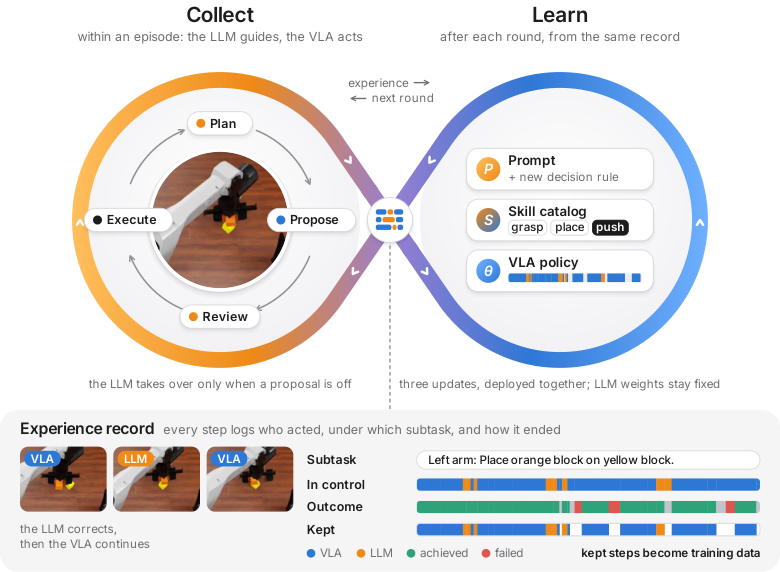

<h1 align="center">ESI: An Embodied Self-Improvement Flywheel for LLM-VLA Agents</h1>

<p align="center">
  <a href="https://arxiv.org/abs/2611.18176"></a>
  &nbsp;
  <a href="https://www.zerith.com/blog/esi/"></a>
</p>

ESI 将 LLM 的规划与纠正能力和 VLA 的动作执行能力结合，通过环境交互持续改善两者的协作。飞轮按 **采集 → 子任务标注 → 数据准备 → 训练 → 下一轮采集** 迭代，也支持可选的经验驱动 prompt 更新。

<p align="center">
  <a href="https://www.zerith.com/blog/esi/">
    
  </a>
</p>

<p align="center"><em>论文 Figure 1：从协作执行到经验学习。点击图片查看交互演示与执行视频。</em></p>

## 部署准备

当前提供 RoboDojo 仿真环境的部署与评测实现。外部项目、资产和模型需单独安装或下载，具体版本与必要补丁见[安装说明](docs/INSTALLATION.md)。

| 项目 | 推荐配置 |
| --- | --- |
| 系统与 CUDA | Linux x86_64，Ubuntu 22.04、CUDA Toolkit 12.8；容器建议使用 `devel` 环境 |
| Python | Python 3.11，RoboDojo 与 OpenPI 使用独立环境 |
| 模拟器 | Isaac Sim 5.1.0，搭配指定版本的 RoboDojo、XPolicyLab、IsaacLab 和 cuRobo |
| 硬件 | 模拟器使用 RTX 渲染 GPU（如 RTX 4090）；VLA 推理／训练可使用独立计算 GPU |

推荐目录如下，路径可在部署配置中修改。保留外部项目内部的目录结构：

```text
/opt/
├── ESI/                                      # 本仓库
├── RoboDojo/
│   ├── Assets -> /mnt/robodojo/Assets
│   ├── XPolicyLab/policy/Pi_05/openpi/        # OpenPI 源码及 .venv
│   └── third_party/                          # IsaacLab、cuRobo
└── envs/RoboDojo/                            # 模拟器与控制工具环境
/mnt/
├── robodojo/Assets/                          # 仿真资产
├── models/esi-final/                         # ESI 模型
├── esi/                                     # 轨迹、标注、训练与评测输出
└── esi-private/                             # 账号认证文件
```

可单机部署，也可将模拟器与策略服务分机部署。入口通过 SSH 启动模拟器，单机时连接本机；多机时，输出目录必须在两端以相同绝对路径访问同一份共享存储。A100/H100 等计算卡不能替代模拟器所需的 RTX 渲染 GPU。

## 项目结构与配置

| 目录 | 用途 |
| --- | --- |
| `scripts/` | 采集、标注、数据准备、训练和评测入口 |
| `configs/` | 部署参数、模型设置及各阶段配方 |
| `hybrid_rollout/robodojo/` | LLM–VLA 控制流程、模拟器与策略服务、prompt 和 skill |
| `data_processing/` | 子任务标注、训练索引、采样与训练 |
| `patches/` | 外部依赖的集成补丁 |

首次部署从单 worker 模板开始，在仓库根目录执行（已有本地配置时不要覆盖）：

```bash
cp -n configs/deployment.eval.example.json configs/deployment.local.json
export ESI_PYTHON=/opt/envs/RoboDojo/bin/python
```

在 `configs/deployment.local.json` 中填写路径、SSH 用户／主机、GPU、并行容量和账号池位置，并完成账号登录。LLM 设置在 `configs/llm.json`，任务在 `configs/tasks.json`，训练参数在 `configs/training/`；其余参数沿用配方即可。账号配置和各阶段完整命令见[配置参考](docs/CONFIGURATION.md)。

## ESI 评测

下载 [ESI-pi05 模型](https://huggingface.co/Embodied-Self-Improvement/ESI-pi05)（约 11.6 GiB）：

```bash
hf download Embodied-Self-Improvement/ESI-pi05 \
  --revision 09395c2dd983b3f4d9dbd877297a2eecfd31ef6e \
  --include "params/**" "assets/**" \
  --local-dir /mnt/models/esi-final
```

`paths.final_checkpoint` 应指向包含 `params/` 和 `assets/` 的下载目录。环境与账号配置完成后，启动评测：

```bash
bash scripts/eval.sh --set run.name=esi_eval --show-config
bash scripts/eval.sh --set run.name=esi_eval
```

默认使用发布的 ESI 模型和 GPT 子任务指导，评测 10 个任务、每任务 20 个 case，采用 benchmark 原生预算与评分。入口自动启动所需服务；`--show-config` 仅预览配置。

基准评测使用 `--config configs/eval/baseline.json`，需另行准备 RoboDojo 预训练权重并配置 `paths.official_checkpoint`。长任务建议在 tmux 内运行；恢复使用原命令和配置，修改实验设置时换一个 `run.name`。

## 飞轮训练

各阶段可独立启动，依次使用上一阶段的产物：

| 阶段 | 入口 | 输入 → 输出 |
| --- | --- | --- |
| 采集 | `scripts/collect.sh` | 模型与任务 → 交互轨迹 |
| 标注 | `scripts/annotate.sh` | 轨迹 → 子任务及结果标注 |
| 数据准备 | `scripts/data.sh` | 轨迹与标注 → 导出数据、训练索引与归一化统计 |
| 训练 | `scripts/train.sh` | 数据索引与模型 → 更新后的 checkpoint |
| 可选 prompt 更新 | `scripts/evolve.sh` | 采集经验 → 供后续运行选择的 prompt bundle |

首轮使用 `configs/collection/bootstrap.json` 和 `configs/annotation/offline.json`；后续使用 `feedforward.json` 和 `online.json`，将新 checkpoint 配置为下一轮采集的模型。训练默认采用 subtask 配方，也可显式选择 task；自动 prompt 更新默认关闭。阶段参数、数据路径与多卡部署方式见上面的配置参考。

## 许可

见 [LICENSE](LICENSE) 和[第三方声明](THIRD_PARTY_NOTICES.md)。外部源码、资产和权重遵循各自许可。
